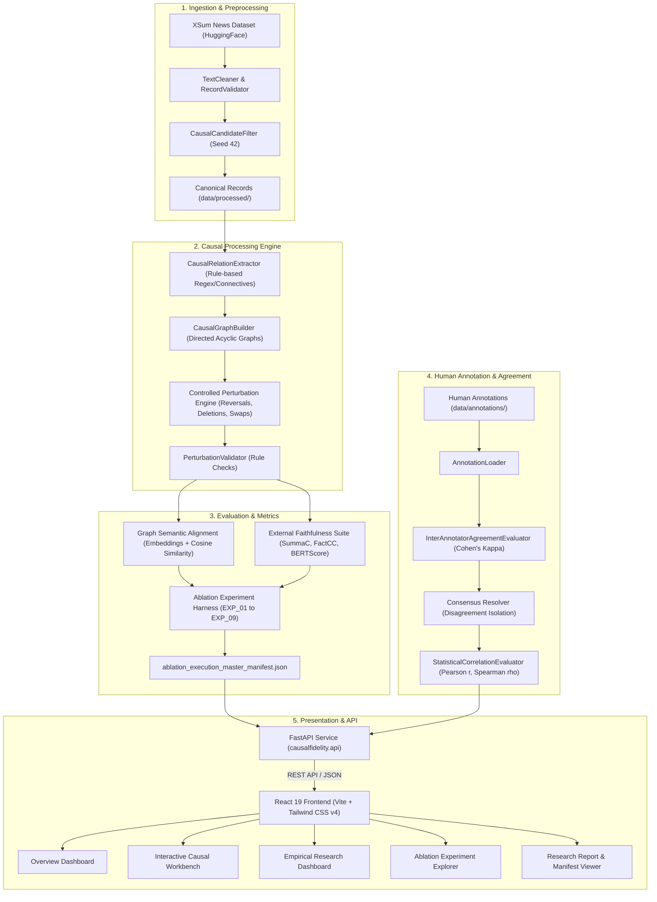

# CausalFidelity+

> **Controlled Causal-Distortion Stress Testing for LLM Summarization**

[](#prerequisites)
[](#backend-startup)
[](#frontend-startup)
[](#technology-stack)
[](#running-tests)

---

## Table of Contents

- [Research Motivation](#research-motivation)
- [Causal Faithfulness in Text Summarization](#causal-faithfulness-in-text-summarization)
  - [The Core Vulnerability](#the-core-vulnerability)
  - [Distortion Taxonomy](#distortion-taxonomy)
- [System Architecture & Data Flow](#system-architecture--data-flow)
- [Interactive Application Features](#interactive-application-features)
- [Technology Stack](#technology-stack)
- [Empirical Research Findings](#empirical-research-findings)
  - [Ablation Study Matrix](#ablation-study-matrix)
  - [Key Quantitative Insights](#key-quantitative-insights)
  - [Human Agreement & Validation](#human-agreement--validation)
- [Research Limitations & Methodological Scope](#research-limitations--methodological-scope)
- [Getting Started](#getting-started)
  - [Prerequisites](#prerequisites)
  - [Installation](#installation)
  - [Backend Startup](#backend-startup)
  - [Frontend Startup](#frontend-startup)
- [Validation & Quality Assurance](#validation--quality-assurance)
  - [Running Backend Tests](#running-backend-tests)
  - [Building Frontend for Production](#building-frontend-for-production)
- [Repository Structure](#repository-structure)
- [Reproducibility & Determinism](#reproducibility--determinism)
- [Citation](#citation)
- [Licensing](#licensing)

---

## Research Motivation

Modern Large Language Models (LLMs) generate fluent, persuasive summaries of long-form documents. However, evaluating their **factual faithfulness** remains an open challenge in Natural Language Processing. Existing automated evaluation metrics—such as NLI-based consistency evaluators (SummaC, FactCC) and token-level semantic similarity metrics (BERTScore)—primarily measure whether entities, predicates, and vocabulary from the source document are preserved in the generated text.

These metrics frequently fail when a summary retains all core entities and actions while altering the **causal relationship** between them. A summary may achieve near-perfect lexical overlap and high NLI entailment scores while asserting the exact reverse of the original text's causal claim, omitting the causal mechanism, or attributing an outcome to an unrelated premise.

**CausalFidelity+** is an open research platform and evaluation testbed engineered to investigate and address this vulnerability. It introduces:
1. A **rule-based causal extraction and graph construction engine** to parse explicit cause-and-effect tuples from text.
2. A **controlled causal perturbation engine** that applies precise synthetic distortions to test metric sensitivity.
3. A **graph-based semantic alignment evaluator** that scores causal correspondence using directional argument matching.
4. An **ablation experiment execution harness** evaluating parameter variations and computational bottlenecks across standard faithfulness metrics.
5. A **FastAPI backend and React 19 interactive interface** (Workbench, Experiment Explorer, Research Dashboard, and Report Viewer) to conduct interactive stress testing and review empirical findings.

---

## Causal Faithfulness in Text Summarization

### The Core Vulnerability

Consider a news article reporting on a public health crisis:

| Text Type | Text Content | FactCC / SummaC Response | Factual Reality |
| :--- | :--- | :--- | :--- |
| **Source Document** | *"Widespread power outages caused municipal water purification systems to fail, leading to citywide boil-water notices."* | Baseline entailment | Ground truth reference |
| **Faithful Summary** | *"Power grid failures caused municipal water issues and subsequent boil-water notices."* | High entailment | **Faithful** (Causal direction preserved) |
| **Causal Reversal** | *"Municipal water purification system failures caused widespread power outages across the city."* | Often scores as consistent due to identical entity overlap | **Hallucinated Causality** (Cause and effect inverted) |
| **Causal Weakening** | *"Widespread power outages were correlated with municipal water purification failures."* | High entailment score | **Weakened Claim** (Deterministic causality degraded to association) |
| **Causal Omission** | *"Widespread power outages occurred, and municipal water purification systems failed."* | Near-perfect lexical overlap | **Mechanistic Loss** (Causal link severed into independent events) |

In conventional summarization benchmarks, the distorted sentences above frequently pass standard hallucination detectors because every named entity (*"power outages"*, *"water purification"*) is grounded in the source text. CausalFidelity+ isolates this phenomenon through structured perturbation and graph-based alignment.

### Distortion Taxonomy

The framework systematically models four primary classes of causal alterations:

```
                          ┌──────────────────────────┐
                          │ Source Document Event A  │
                          │   causes Event B (A → B) │
                          └─────────────┬────────────┘
                                        │
           ┌─────────────────┬──────────┴──────────┬─────────────────┐
           ▼                 ▼                     ▼                 ▼
   [Causal Reversal]  [Causal Weakening]    [Causal Omission]  [Argument Swap]
        B → A           A correlates with B       A and B           C → B (imposter C)
  (Direction Inverted)  (Modal/Strength Lost)  (Link Severed)   (Premise Altered)
```

1. **Causal Reversal**: The antecedent (cause) and consequent (effect) are inverted ($A \to B$ becomes $B \to A$).
2. **Causal Weakening**: A deterministic or definitive causal link ($A \to B$) is reduced to a weak association or coincidence ($A \text{ and } B \text{ were observed together}$).
3. **Causal Omission / Deletion**: The explicit connective is removed, converting a causal dependency into two syntactically independent coordinate clauses.
4. **Cause / Effect Argument Alteration**: The connective is preserved, but one argument is replaced with an ungrounded or distractor event from elsewhere in the discourse context.

---

## System Architecture & Data Flow

CausalFidelity+ integrates a Python evaluation core, a RESTful API layer, and a web interface:



---

## Interactive Application Features

The frontend interface provides researchers with five integrated views:

### 1. Overview Dashboard
- Displays key project metrics: benchmark agreement rate (83.33%), baseline alignment score (0.3195), test suite status (292 tests passing), and real-time backend health check.
- High-level architecture summary with rapid navigation cards to the workbench and experiment explorer.

### 2. Causal Workbench
- Interactive testing sandbox allowing arbitrary text input or preloaded research examples.
- Runs source and summary causal extraction, builds relation tuples, computes argument-level cosine similarities, and calculates composite alignment scores on demand.
- Visual inspection of detected causes, effects, and relational trigger words.

### 3. Empirical Research Dashboard
- Presents verified empirical results across the 9 ablation experiments with comparison cards and radar charts.
- Highlights component weighting sensitivities (+56.81% for equal weighting, -20.97% for argument-only weighting).
- Documents computational runtime bottlenecks (identifying SummaCConv's 79.17% pipeline runtime overhead).
- Dedicated **Research Limitations & Scope** card grid outlining benchmark sample size, human agreement, extraction boundaries, and NLI sensitivity.

### 4. Ablation Experiment Explorer
- Comprehensive directory of all 9 experimental configurations (`EXP_01_BASELINE` through `EXP_09_HUMAN_CORRELATION`).
- Filter experiments by category: Baseline, Similarity Threshold Ablation, Weighting Model Ablation, Component Ablation, or Evaluation Metric Comparison.
- Inspect parameter overrides, runtime measurements, and output metrics without viewing internal filesystem paths.

### 5. Research Reports & Master Manifests Viewer
- Document-style modal viewer serving authoritative Markdown reports and JSON summaries live from backend endpoints.
- Displays the **Controlled Distortion Stress Test Report**, **Research Findings Analysis**, **Final Research Summary (JSON)**, and **Ablation Execution Master Manifest (JSON)**.
- Features formatted Markdown rendering, search/filter controls, and JSON formatting.

---

## Technology Stack

### Backend & Machine Learning
- **Python**: 3.11+
- **API Framework**: FastAPI `0.110.0` with Uvicorn `0.28.0` ASGI server
- **Data Validation & Schemas**: Pydantic `2.6.4` & Pydantic-Core
- **Deep Learning & NLI Backbones**: PyTorch `2.2.1+cpu`, HuggingFace Transformers `4.38.2`, Datasets `2.18.0`
- **Embedding Models**: Sentence-Transformers `2.5.1` (`all-MiniLM-L6-v2`)
- **Evaluation Metrics**: SummaC `0.2.1` (SummaCConv), BERTScore `0.3.13`
- **Scientific Computing & Graph Processing**: NumPy `1.26.4`, SciPy `1.12.0`, NetworkX `3.2.1`, scikit-learn `1.4.1.post1`, Matplotlib `3.8.3`
- **Configuration & Environment**: PyYAML `6.0.1`, python-dotenv `1.0.1`
- **Testing & API Verification**: PyTest `8.1.1`, HTTPX `0.27.0`

### Frontend Application
- **Framework**: React `19.0.0` with TypeScript `5.7.2`
- **Build System**: Vite `6.0.7`
- **Styling**: Tailwind CSS `v4.0.0-alpha.31` with `@tailwindcss/vite`
- **Icons**: Lucide React `0.475.0`
- **Routing**: React Router DOM `7.2.0`

---

## Empirical Research Findings

The research platform executed a controlled matrix of 9 ablation experiments to evaluate metric sensitivities, computational costs, and human alignment.

### Ablation Study Matrix

All 9 experiments operated under controlled random seed (`seed: 42`) over the benchmark evaluation set:

| Experiment ID | Category | Parameter Variation | Mean Alignment | Relative Diff | Runtime |
| :--- | :--- | :--- | :---: | :---: | :---: |
| `EXP_01_BASELINE` | Baseline Reference | Default weights ($0.45/0.45/0.10$), thresholds ($0.5/0.5/0.6$) | **0.3195** | Baseline | 706.99 s |
| `EXP_02_THRESH_PERMISSIVE` | Threshold Ablation | Permissive thresholds ($0.35/0.35/0.45$) | 0.3195 | 0.00%* | 305.07 s |
| `EXP_03_THRESH_STRICT` | Threshold Ablation | Strict thresholds ($0.65/0.65/0.75$) | 0.3195 | 0.00%* | 310.22 s |
| `EXP_04_WEIGHT_EQUAL` | Weighting Ablation | Equal weights ($0.33/0.33/0.34$ across cause, effect, relation) | **0.5010** | **+56.81%** | 307.39 s |
| `EXP_05_WEIGHT_ARG_ONLY` | Weighting Ablation | Arguments only ($0.50/0.50/0.00$), connective ignored | **0.2525** | **-20.97%** | 304.55 s |
| `EXP_06_ABLATE_SUMMAC` | Component Ablation | SummaC disabled (`summac_enabled=false`) | 0.3195 | 0.00% | **147.28 s** |
| `EXP_07_ABLATE_FACTCC` | Component Ablation | FactCC disabled (`factcc_enabled=false`) | 0.3195 | 0.00% | 298.11 s |
| `EXP_08_ABLATE_BERTSCORE` | Component Ablation | BERTScore disabled (`bertscore_enabled=false`) | 0.3195 | 0.00% | 569.21 s |
| `EXP_09_HUMAN_CORRELATION`| Metric Comparison | Human consensus correlation ($n=6$ consensus pairs) | — | — | 0.16 s |

*\*Note on Threshold Ablations: Modifying binary classification decision thresholds altered candidate filtering boundaries without changing the underlying continuous embedding cosine similarities.*

### Key Quantitative Insights

1. **Component Weighting Drives Composite Sensitivity**:
   The relative contribution of relation connectives vs. cause/effect argument embeddings is the dominant factor governing composite score behavior. Assigning equal weight ($0.34$) to the relational trigger word increases average alignment scores by **+56.81%** ($0.5010$), whereas discarding the relation trigger ($0.00$) decreases alignment scores by **-20.97%** ($0.2525$).
2. **Computational Bottleneck Isolation**:
   SummaCConv accounts for approximately **79.17%** of the full pipeline runtime (and **86.27%** of external metric computation time). Disabling SummaC (`EXP_06`) reduces total pipeline execution time from 706.99 s to 147.28 s.
3. **Pretrained NLI Insensitivity to Causal Reversals**:
   Off-the-shelf NLI models (SummaC, FactCC) exhibit near-zero score changes when cause and effect clauses are flipped:
   - SummaC mean score delta: $+0.0023$ (statistically indistinguishable from zero)
   - FactCC mean score delta: $-0.0015$
   - BERTScore mean F1: $0.9698$ (loss of only $0.0302$)
   These results indicate that pretrained entailment backbones are heavily biased by shared bag-of-words semantics rather than directional dependency logic.

### Human Agreement & Validation

- **Human Annotations**: Ingested 12 human annotation records across controlled distortion pairs.
- **Inter-Annotator Agreement**: Cohen's $\kappa = 0.60$ for causal classification; observed agreement rate of **83.33%** across paired evaluation items.
- **Disagreement Isolation**: 6 disputed items where annotators disagreed were explicitly tagged as `DISAGREED` and isolated from binary distortion target vectors to prevent false assumption of faithfulness.
- **Correlation with Naturalness**: Pearson $r = -0.3162$ and Spearman $\rho = -0.3162$ between metric score delta and human naturalness ratings on the evaluated subset.

---

## Research Limitations & Methodological Scope

To ensure scientific integrity, the findings reported above must be interpreted within the following documented boundaries:

1. **Controlled Benchmark Sample Size**:
   The current empirical ablation matrix was evaluated on a controlled development set of $n=6$ validated perturbation pairs derived from $n=100$ XSum news articles. While sufficient for deterministic pipeline stress testing, generalizable assertions require scaling to large multi-domain corpora.
2. **Human Validation Sample Size**:
   The human validation phase analyzed $n=12$ annotation records ($n=6$ consensus items). Because all controlled test items in this subset contained synthetic distortions, the ground-truth binary distortion vector exhibited zero variance, rendering receiver operating characteristic (ROC-AUC) curves mathematically undefined for this subset.
3. **Rule-Based Causal Extraction Scope**:
   Causal relation extraction relies on deterministic grammatical patterns and explicit connective keywords (e.g., *caused*, *led to*, *due to*, *because*, *triggered*). Implicit causal reasoning across discourse boundaries without explicit lexical connectives is outside the scope of the rule-based extractor.
4. **Pretrained Metric Weights**:
   External evaluators (SummaCConv, FactCC, BERTScore) were evaluated using fixed pretrained checkpoints. No domain-specific fine-tuning or parameter updates were performed on these baseline models.

---

## Getting Started

### Prerequisites

- **Python**: Version `3.11` or higher
- **Node.js**: Version `18.x` or higher (with `npm` package manager)
- **Operating System**: Linux, macOS, or Windows

### Installation

1. **Clone the repository**:
   ```bash
   git clone <repository-url>
   cd CasualFidelityPlus
   ```

2. **Set up Python virtual environment**:
   ```bash
   python -m venv .venv

   # On Windows (PowerShell):
   .venv\Scripts\Activate.ps1

   # On Linux / macOS:
   source .venv/bin/activate
   ```

3. **Install Python dependencies**:
   ```bash
   pip install --upgrade pip
   pip install -r requirements.txt
   ```
   > **Note on PyTorch**: The default `requirements.txt` installs standard PyTorch. If you intend to run intensive neural inference with GPU acceleration, install the appropriate CUDA build from [pytorch.org](https://pytorch.org/).

4. **Install frontend dependencies**:
   ```bash
   cd frontend
   npm install
   cd ..
   ```

---

### Backend Startup

The FastAPI backend exposes the REST API, serves research report artifacts, and handles causal extraction and alignment requests.

**On Windows (PowerShell)**:
```powershell
$env:PYTHONPATH="src"
python -m uvicorn causalfidelity.api.main:app --reload --host 0.0.0.0 --port 8000
```

**On Linux / macOS**:
```bash
PYTHONPATH=src python -m uvicorn causalfidelity.api.main:app --reload --host 0.0.0.0 --port 8000
```

Once running:
- **API Base URL**: `http://localhost:8000/api/v1`
- **Interactive OpenAPI Documentation (Swagger UI)**: `http://localhost:8000/docs`
- **Alternative Documentation (ReDoc)**: `http://localhost:8000/redoc`
- **Health Check**: `http://localhost:8000/api/v1/health`

---

### Frontend Startup

The React application runs via Vite and communicates with the FastAPI backend at `http://localhost:8000/api/v1`.

```bash
cd frontend
npm run dev
```

Once running:
- **Web Interface**: `http://localhost:5173/`
- The client automatically checks backend connectivity on load and displays an indicator in the sidebar footer.

---

## Validation & Quality Assurance

### Running Backend Tests

The Python test suite covers data pipelines, causal extraction, graph construction, perturbation generation, validation, alignment, ablation harnesses, human agreement evaluation, and FastAPI endpoints.

Run the full test suite using `pytest`:

```bash
# Run all tests
python -m pytest -o pythonpath=src tests

# Run with verbose output
python -m pytest -o pythonpath=src tests -v

# Run API-specific test suite
python -m pytest -o pythonpath=src tests/api/ -v
```

*Expected result*: **292 passed** (zero failures, zero errors).

### Building Frontend for Production

Verify TypeScript type safety and compile the production bundle:

```bash
cd frontend
npm run build
```

*Expected result*: TypeScript compiles with zero errors, producing an optimized build in `frontend/dist/`.

---

## Repository Structure

```
CasualFidelityPlus/
├── .gitignore                      # Git exclusion rules preserving authoritative reports
├── README.md                       # Research documentation and platform guide
├── requirements.txt                # Verified Python 3.11 dependencies
├── config/                         # Project and logging configurations
│   ├── default.yaml                # Default pipeline parameters and thresholds
│   └── logging.yaml                # Structured logging configuration
├── data/
│   ├── annotations/                # Human evaluation records
│   │   └── human_annotations.jsonl # 12 human annotation benchmark records
│   └── processed/                  # Normalized canonical datasets
│       ├── xsum_dev.jsonl          # Preprocessed development records
│       └── xsum_dev_stats.json     # Empirical candidate filter statistics
├── src/
│   └── causalfidelity/             # Core Python package
│       ├── alignment/              # Graph semantic alignment and scoring
│       ├── annotation/             # Human agreement (Cohen's Kappa) and correlation
│       ├── api/                    # FastAPI service, routers, and Pydantic schemas
│       │   ├── routes/             # Endpoints: /health, /distortion, /reports, /experiments
│       │   ├── exceptions.py       # Standardized HTTP error handlers
│       │   ├── main.py             # FastAPI application entry point
│       │   └── schemas.py          # Request and response models
│       ├── data/                   # Dataset streaming, cleaning, and schemas
│       ├── distortion/             # Perturbation engines and validation rules
│       ├── evaluation/             # External metrics integration (SummaC, FactCC, BERTScore)
│       ├── experiment/             # Ablation study harness and matrix runner
│       ├── extraction/             # Causal relation extraction (regex/connectives)
│       └── graph/                  # Directed causal graph construction
├── frontend/                       # React 19 + TypeScript + Vite application
│   ├── src/
│   │   ├── components/             # Reusable UI components and modal viewers
│   │   │   ├── ExperimentDetailsModal.tsx # Experiment inspection modal
│   │   │   ├── ReportModal.tsx     # Markdown & JSON report viewer modal
│   │   │   └── Sidebar.tsx         # Navigation sidebar and API connection indicator
│   │   ├── pages/                  # Top-level view routes
│   │   │   ├── Dashboard.tsx       # Platform overview
│   │   │   ├── Workbench.tsx       # Interactive causal distortion workbench
│   │   │   ├── ResearchDashboard.tsx # Empirical ablation findings and charts
│   │   │   ├── ExperimentExplorer.tsx # 9-experiment matrix browser
│   │   │   └── Reports.tsx         # Authoritative reports viewer
│   │   ├── services/               # HTTP client integration with FastAPI
│   │   └── types/                  # TypeScript interface definitions
│   ├── package.json                # Frontend package dependencies
│   └── vite.config.ts              # Vite build configuration
├── outputs/
│   ├── reports/                    # High-level architecture and audit reports
│   └── results/                    # Authoritative empirical research artifacts
│       ├── ablation_execution_master_manifest.json # Complete 9-experiment matrix data
│       ├── phase13_final_research_report.md        # Comprehensive research report
│       ├── phase13_final_research_summary.json     # Machine-readable summary stats
│       └── phase13_step4_results_analysis.md       # Empirical results analysis
└── tests/                          # 292 unit, regression, and integration tests
    ├── alignment/                  # Semantic alignment tests
    ├── annotation/                 # Agreement and correlation evaluator tests
    ├── api/                        # FastAPI route and schema tests
    ├── data/                       # Preprocessing and validation tests
    ├── distortion/                 # Perturbation engine tests
    ├── evaluation/                 # Metric adapter tests
    ├── experiment/                 # Ablation harness tests
    ├── extraction/                 # Causal relation extraction tests
    └── graph/                      # Directed graph tests
```

---

## Reproducibility & Determinism

All empirical experiments, sample extractions, and human validation benchmarks in CausalFidelity+ were generated under strict reproducibility controls:
- **Deterministic Random Seed**: `seed = 42` is fixed across sampling, dataset splitting, and perturbation generation.
- **Master Manifest Validation**: All experimental parameters and outputs are cross-referenced against [`outputs/results/ablation_execution_master_manifest.json`](outputs/results/ablation_execution_master_manifest.json).
- **Portable File Paths**: Artifact references and report manifests use project-relative POSIX paths to guarantee cross-platform execution without local environment leaks.

---

## Citation

If you use CausalFidelity+ in your research, please cite this framework as follows:

```bibtex
@misc{causalfidelityplus2026,
  title        = {CausalFidelity+: Controlled Causal-Distortion Stress Testing for LLM Summarization},
  author       = {CausalFidelity+ Research Team},
  year         = {2026},
  howpublished = {\url{https://github.com/<owner>/CasualFidelityPlus}},
  note         = {NLP evaluation framework for causal faithfulness and relation distortion}
}
```

---

## Licensing

**Licensing Status**: *To be decided*.

The intellectual property, architecture, and code in this repository are currently prepared for pre-publication evaluation. An open-source license (such as MIT or Apache 2.0) has not yet been formally assigned. Licensing terms will be finalized prior to public distribution.

*External Datasets*: The XSum dataset (`EdinburghNLP/xsum`) is utilized in accordance with its original distribution terms and is dynamically streamed via HuggingFace Datasets rather than redistributed within this repository.
